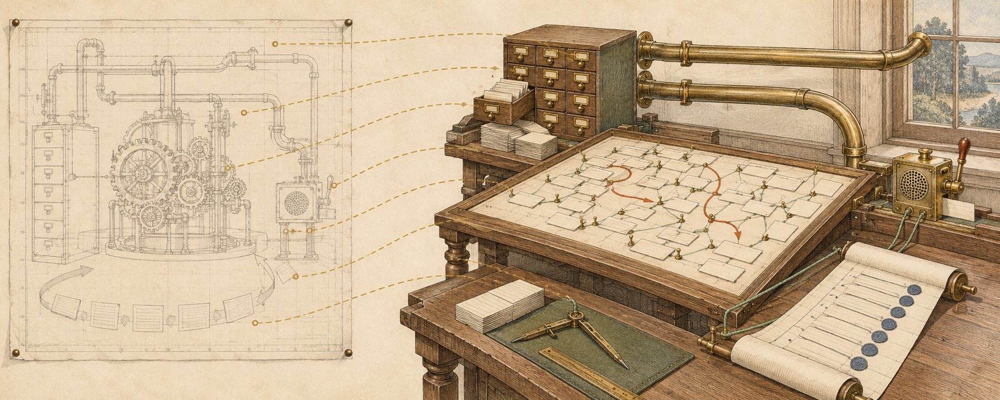

# Evolving Agents

<p align="center">
  
</p>

> **The director: Evolving Agents' SystemAgent, rebuilt on what we measured.**
>
> In 2025 Evolving Agents had a system agent that orchestrated, a smart memory, a library and a bus of agents,
> Firmware rules and an evolution loop — and three test functions. The **director** keeps every one of those ideas
> and pins each to a measurement. It keeps your team's way of working as a memory of small, linked, verifiable
> statements; plans by walking it; delegates each step to a frontier model, a local model or another harness; and
> learns from every task through a gated, versioned patch. It ships as a **Claude Code plugin** today and is built
> to move, memory and gate unchanged, to **Anthropic's Managed Agents** and **Google's Antigravity agent** next.

[](https://github.com/EvolvingAgentsLabs/evolving-agents/stargazers)
[](https://opensource.org/licenses/Apache-2.0)
[](ROADMAP.md)

**Contents** — [Your CLAUDE.md, actually followed](#your-claudemd-actually-followed) ·
[Install](#install) · [From the SystemAgent to the director](#from-the-systemagent-to-the-director) ·
[One harness today, three next](#one-harness-today-three-next) · [Measured](#measured) ·
[What comes next](#what-comes-next) · [Earlier work in this repository](#earlier-work-in-this-repository)

## Your CLAUDE.md, actually followed

You wrote the rules down. Your agent still breaks them under pressure — **on 14 real situations, a Claude Code
session planning with Sonnet 5.5 and the rules loaded planned by them 0.589 of the time; the director, walking the
same rules compiled into linked statements, 0.929.** If you keep a `CLAUDE.md`, an `AGENTS.md` or Claude Code's
memory, this is for you:

> **Measured with Sonnet. With Opus 5.5 planning (2026-10-21) the gap is not there:** today's session alone follows
> the same rules 0.964 of the time ([D0O](packages/director/docs/BRIEF-D0O.md)) and keeps a multi-day thread's
> decisions 0.80 against the director's 0.85 ([C2](packages/director/docs/BRIEF-C2.md)). What the director still
> showed with Opus is cost — 34 % less per plan in C2. Whether it helps the strongest model on harder, newer
> situations is the next measurement; until then, read every number below as Sonnet's.

- **it recalls the rule at the moment it applies** — and cites the statement it followed in every step of its plan;
- **it learns from your corrections** — each lesson proposed, checked against what it already knew, and kept only
  if you accept it, as a reversible, versioned patch;
- **it learns where you want work done** — move a task from the frontier to your local model once, and it plans the
  next one like it there;
- **rules that must hold are code, not requests** — a task marked confidential never leaves for a lane not cleared
  for it, the frontier included.

## Install

<p align="center">
  
</p>

**As a Claude Code plugin** — inside Claude Code:

```
/plugin install director --marketplace EvolvingAgentsLabs/evolving-agents
/director:compile        # your CLAUDE.md, AGENTS.md and memory → linked statements (asks first; ~US$5 for ~60 files)
/director:reflect        # after a task: the correction becomes a proposed edit, kept only on your yes
/director:recipes        # optional: recipes a local model follows to plan from the memory, free and in ~10 s
```

From the next session on, every plan walks your memory and cites what it follows. The plugin carries the walk
intact: **0.929** through it, the same as the director harness, on the same 14 situations
([P0](packages/director/docs/BRIEF-P0.md)). The status line names the memory and what waits for you; a band above
the prompt shows each proposed lesson with **Diff**, **Accept** and **Reject**, each plan's delegations before they
run, and each task delegated to another lane until its result is fetched.

**Published flat, too.** Keeping the lanes' facts as one directory of data instead of prose routed as well (0.880 vs
0.864) but broke clearance more often and did not follow a lane going down well enough, so it was not built
([D16](packages/director/docs/BRIEF-D16.md)).

**Or the harness, with its two-lane interface** (frontier and local model side by side):

```bash
git clone https://github.com/EvolvingAgentsLabs/evolving-agents && cd evolving-agents/packages/director
python3 -m director.compile --claude-md ~/your-project/CLAUDE.md \
    --memory-dir ~/.claude/projects/<your-project>/memory --workdir ~/your-project
python3 -m director.server --config ~/.config/director/director.json      # open http://127.0.0.1:8740
```

Needs Python 3.10+ and [Claude Code](https://code.claude.com) (`claude` on your PATH). Standard library only. The
memory stays on your machine. What it costs, what it does not do yet, and every measurement:
[`packages/director/`](packages/director/).

## From the SystemAgent to the director

<p align="center">
  
</p>

The Evolving Agents Toolkit (EAT, 2025, kept in [`legacy/eat/`](legacy/eat/)) had the right parts and pinned none of
them to a measurement: 18,680 lines, three test functions. The director keeps the parts and changes how each one
works — the full analysis is [**docs/EVOLUTION.md**](docs/EVOLUTION.md).

| EAT, 2025 | the director, today | what changed, and the evidence |
|---|---|---|
| **SystemAgent** — the orchestrator | **the director**: plans, routes, delegates, reflects | it no longer runs a loop of its own; the harness does ([P0](packages/director/docs/BRIEF-P0.md)) |
| **ArchitectZero** — designed solutions | **the walk**: index → statements → links, every step citing the rule it follows | the design comes from the team's own rules, not a second agent: 0.929 vs 0.589 ([D0](packages/director/docs/BRIEF-D0.md)) |
| **Smart Memory** — experiences, searched by embedding | **operational memory**: atomic When / Do / Because statements, linked; plus an episodic journal and a directory | organisation, not retrieval, carries the effect: told to walk its files, the plain session reached 0.768; similarity search found 0.77 of the rules a case needs ([D13](packages/director/docs/BRIEF-D13.md)) |
| **ContextBuilderTool / ExperienceRecorderTool** | **`/director:compile`** in, **`/director:reflect`** out | a lesson is a gated patch, not a log line: 0.0 → 0.781 on held-out probes, D0 re-checked at 0.964 ([D2](packages/director/docs/BRIEF-D2.md)) |
| **SmartLibrary + SmartAgentBus** — find a capability, route to it | **lanes**: `delegate`, `lane_status`, `lane_fetch` to Claude Code, local models or any command | learned from one move: 0 / 6 → 6 / 6 ([D3](packages/director/docs/BRIEF-D3.md)) |
| **Firmware** — governance as instructions to the model | **hooks and code**: the confidentiality rule in `lanes.py`, Accept behind lint and a guard | a rule that must hold is enforced, not asked for |
| **EvolutionStrategist** — which component to evolve | **the gate**: lint, the lesson's own probes (TEACHES), a targeted guard, a person's yes, an [agentvcs](https://github.com/EvolvingAgentsLabs/agentvcs) patch | the guard refused both planted breaks and no unchanged memory ([D6](packages/director/docs/BRIEF-D6.md), [D7](packages/director/docs/BRIEF-D7.md)) |
| **MongoDB** | Markdown files, versioned by agentvcs | files travel to every harness; every lesson can be blamed or bisected |

What we chose **not** to revive, with the reason for each — a memory agent in the read path, vector search as the
map, governance written as prompts, a framework adapter per vendor — is in [EVOLUTION §7](docs/EVOLUTION.md#7-promises-still-open).

## One harness today, three next

<p align="center">
  
</p>

**The harness is rented, never built.** The director decides *what* to do (the walk), *where* (the lanes), *whether
a lesson is kept* (the gate) and keeps the *evidence* (the journal). Model calls, tools, the sandbox and context
belong to a harness. Claude Code is one on your machine; Managed Agents is the same kind of harness hosted by
Anthropic; the Antigravity agent is Google's. All three read skills as `SKILL.md` and call MCP servers, and the
memory is plain files — so moving is packaging, not a rewrite.

| lane | harness | status |
|---|---|---|
| frontier | the Claude Code session you are in — the plugin | **built** — 0.929 ([P0](packages/director/docs/BRIEF-P0.md)) |
| `claude -p` | Claude Code, headless | **built** |
| local | Ollama / llama.cpp; [lora-kernel](https://github.com/EvolvingAgentsLabs/lora-kernel)'s specialists | **built** — gemma4:12b plans from recipes at 0.806 vs 0.854, at no cost ([D15](packages/director/docs/BRIEF-D15.md)) |
| command | anything with `submit` / `status` / `fetch` | **built** |
| `anthropic-managed` | Anthropic **Managed Agents** | **planned** — P1 |
| `antigravity` | Google's **Antigravity agent** | **planned** — P2 |

Each managed harness must earn its place the same way the plugin did: plan D0's 14 situations within 0.03 of 0.929
through it, or say by how much it fails. On every harness the operational memory is mounted **read-only** — a lesson
comes back through the gate, never written in place — and a cloud lane is not cleared for confidential work unless
you clear it. Conditions and reasons: [EVOLUTION §5](docs/EVOLUTION.md#5-agents-and-harnesses).

## Measured

<p align="center">
  
</p>

| plan by walking the memory | learn from a task | learn where work runs |
|---|---|---|
|  |  |  |

Every number has a brief written before it ran, with the condition that would have falsified it; the flat ones are
published too — a small model walking the memory on its own did not plan well (D8–D12), and similarity search alone
does not find the rules a case needs (D13). Briefs and runners: [`packages/director/docs/`](packages/director/docs/).

## What comes next

[**ROADMAP.md**](ROADMAP.md) has the steps and how each will be judged; [docs/EVOLUTION.md §8](docs/EVOLUTION.md#8-the-order)
orders the longer view: the memory model in code, the directory as data, component evolution (the promise of the
name, still open), then the `anthropic-managed` and `antigravity` lanes, then one memory package that installs on
every harness.

**Built with**, from the same lab: [**lora-kernel**](https://github.com/EvolvingAgentsLabs/lora-kernel), the local
lane — one small resident model, many specialists, a router that abstains to the frontier ·
[**agentvcs**](https://github.com/EvolvingAgentsLabs/agentvcs), the ledger — every lesson the director keeps is a
gated patch you can diff, blame and bisect · [**gene-evidence**](https://github.com/EvolvingAgentsLabs/gene-evidence),
a case study in reports where every sentence cites its evidence. All projects:
[evolvingagentslabs.github.io](https://evolvingagentslabs.github.io).

---

## Earlier work in this repository

| | |
|---|---|
| [`packages/director/`](packages/director/) | **Active — the project.** The director and its Claude Code plugin |
| [`legacy/eat/`](legacy/eat/) | The Evolving Agents Toolkit, 2025, the director's ancestor. Kept readable; its 2025 README is [docs/README-EAT-2025.md](docs/README-EAT-2025.md) |
| [`plugin/`](plugin/) | **Paused.** A Claude Agent SDK plugin that versions an agent's evolution (commit, diff, merge, freeze on a passing eval). Its ideas continued in agentvcs; merging two forked *sessions* ([M1](PLAN.md)) never started |
| [`ai-os/`](ai-os/) | **Paused** since 2026-09-06. An agent-based operating system on the [qm](https://github.com/yc-software/qm) base, kept as a subtree |
| [`packages/memory/`](packages/memory/) | Structured recall above Claude Code's flat memory files. Works; measures no better than naive matching ([PLAN.md](PLAN.md)) |
| [`packages/agentvcs/`](packages/agentvcs/) | **Frozen copy.** agentvcs lives in [EvolvingAgentsLabs/agentvcs](https://github.com/EvolvingAgentsLabs/agentvcs) |
| [`demos/robot/`](demos/robot/) | A 2D robot that evolves its own skills, versioned with agentvcs |

<details>
<summary><b>What the 2025 toolkit taught us — three flat results</b></summary>

EAT was not a product that failed; it was an architecture written down and never pinned to anything that could
contradict it. 10,165 of its lines were deleted where the Agent SDK does the same better —
[docs/WHAT-WAS-DELETED.md](docs/WHAT-WAS-DELETED.md) lists each one and what replaced it. Rebuilt and measured since:

- **The dual-embedding resolver does not help.** EAT indexed every component twice — what it is, and what it is
  *for*. 80% acc@1 either way; the second axis is distinct (`cosine = 0.753`) and buys nothing on a modern encoder.
- **Retrieving past experience buys nothing on the task.** The premise of `SmartMemory` and `ContextBuilderTool`,
  measured three times: **−4**, **+0** (p = 1.0000) and **−6** against retrievers up to an oracle. What did move was
  a **compact statement of a rule** induced from the same trajectories: +21 over the oracle — which is what the
  director's memory is made of.
- **The memory hierarchy loses to lexical search.** Four levels, as EAT's smart memory argued: exact search 3/3 at
  every corpus size, hierarchical navigation 1–2/3.

It was right about where to look and wrong about what would be there. That is why it is in `legacy/`, not deleted.

</details>

<details>
<summary><b>Breaking change: <code>pip install</code> no longer installs <code>evolving_agents</code></b></summary>

This is a monorepo now; install what you want by name. The 2025 package sits at `legacy/eat/` with its original
`setup.py`, unchanged. agentvcs was never published to PyPI; the frozen copy installs from source:

```bash
pip install "git+https://github.com/EvolvingAgentsLabs/evolving-agents#subdirectory=packages/agentvcs"
```

The maintained agentvcs is [EvolvingAgentsLabs/agentvcs](https://github.com/EvolvingAgentsLabs/agentvcs).

</details>

---

<sub>By [Matias Molinas](https://github.com/matiasmolinas) and
[Ismael Faro](https://github.com/ismaelfaro) · Apache 2.0</sub>
