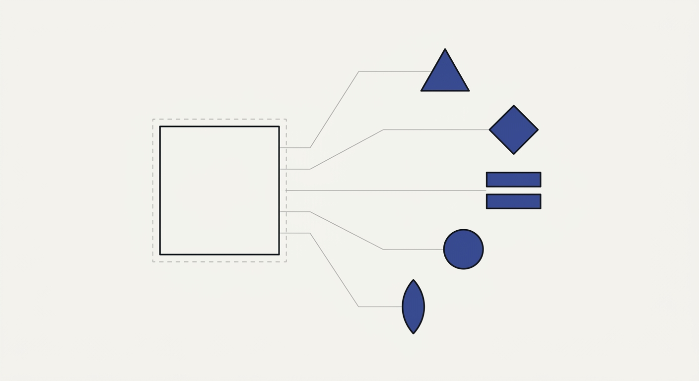

# Evolving Agents

<p align="center">
  
</p>

> **An open lab for agents that learn how a team works — and can show what they learned.**
>
> A **director** keeps the team's way of working as a memory of small, linked, verifiable statements. It plans
> by walking that memory, hands each step to a frontier model or to small local specialists, and learns from
> every task — each lesson a gated, versioned patch that can be blamed or bisected. Every number below was
> measured, including the ones that came back flat.

[](https://opensource.org/licenses/Apache-2.0)

## The system

| piece | what it does | measured [ran] | where |
|---|---|---|---|
| **director** | the meta-agent: walks the operational memory to plan, delegates to Claude Code or to local models, learns from each task and from where the user moves work | planning the team's way **0.929** vs **0.589** for today's session (14 real situations); learning from tasks **0.0 → 0.781** on held-out probes, nothing broken (0.964); learning the lane **0 / 6 → 6 / 6** after one move | [`packages/director/`](packages/director/) — here |
| **lora-kernel** | the local lane: one small resident model, many specialists (adapter + library + scoped tools), a router that abstains to the frontier | a specialist beats the bare base on its job, 70/70 vs 27/70; 0 of 600 foreign texts served locally; edited facts answered 17/17 with no retraining | [lora-kernel](https://github.com/EvolvingAgentsLabs/lora-kernel) |
| **agentvcs** | the ledger: every change to a harness — and every lesson the director keeps — is a gated patch you can diff, merge, blame and bisect | protocol conformance 117/117; on a real model, blame credited +0.442 to exactly the one patch applied mid-run; bisect names a regression blame can only credit jointly | [agentvcs](https://github.com/EvolvingAgentsLabs/agentvcs) |
| **gene-evidence** | the case study: a report on a predicted gene in which every sentence cites the tool output it rests on, the same bytes on every run | built and reproducible; its known limitation, measured: it explains candidates, it does not rank them | [gene-evidence](https://github.com/EvolvingAgentsLabs/gene-evidence) |

<p align="center">
  
</p>

**How the pieces connect — built, and planned.** *Built:* the director delegates to Claude Code and to any
OpenAI-compatible local server (it ran on llama.cpp on a 16 GB laptop), and every memory edit it keeps is an
agentvcs patch, gated and applied (`blame` credits the learning patch with its +0.781); agentvcs reads
lora-kernel's configuration as a manifest and gates changes to it. *Planned:* the director's local lane through
lora-kernel's specialists and router, rather than a bare model; gene-evidence's reports drafted by a lora-kernel
specialist and versioned by agentvcs.

## The director, in three pictures

| plan by walking the memory | learn from a task | learn where work runs |
|---|---|---|
|  |  |  |

What it is, how to run its interface, and every measurement with its brief: [`packages/director/`](packages/director/).

## The organisation's public projects

| | | status |
|---|---|---|
| **evolving-agents** (this repository) | The hub: the **director**, and the lab's earlier work — the Agent SDK plugin, the `ai-os` subtree, `packages/`, the robot demo, the 2025 toolkit | **active** — the director; the rest paused |
| [lora-kernel](https://github.com/EvolvingAgentsLabs/lora-kernel) | An operating layer for specialized local AI agents: one small resident model, many specialists, a router that abstains to a frontier model | active |
| [agentvcs](https://github.com/EvolvingAgentsLabs/agentvcs) | Version control for live-patched agent systems: a Rust core, gates, merge with Claude Code, blame and bisect | active |
| [gene-evidence](https://github.com/EvolvingAgentsLabs/gene-evidence) | An evidence report for predicted genes, every sentence cited | active — prototype |
| [verified-runtime](https://github.com/EvolvingAgentsLabs/verified-runtime) | model × harness × representation × verifier, the measurement bench before lora-kernel | paused |
| [physics-verifiers](https://github.com/EvolvingAgentsLabs/physics-verifiers) | RL environments whose reward is computed by physics; what stands is a generator of tasks with exact truth | paused — last change 2026-08-16 |
| [nightshift](https://github.com/EvolvingAgentsLabs/nightshift) | A procedural and epistemic memory engine, as a Claude Code plugin | proof of concept — last change 2026-08-31 |
| [evolvingagentslabs.github.io](https://github.com/EvolvingAgentsLabs/evolvingagentslabs.github.io) | The website, with a nightly check of every number it publishes | active |

Twenty-five more repositories are archived and read-only; each is listed, with
where it moved, at [evolvingagentslabs.github.io/archive](https://evolvingagentslabs.github.io/archive/#all-archived).

---

## The Agent SDK plugin (paused)

<p align="center">
  
</p>

> **The loop is solved. What happens after the fork is not.** A plugin for the
> [Claude Agent SDK](https://code.claude.com/docs/en/agent-sdk/overview) that versions an agent's evolution — diff
> it, merge it, refuse to ship it when the eval fails. Its ideas continued in agentvcs; the director is where they
> now run.

### The gap

The Agent SDK runs the loop, ships the tools, manages context, and enforces
permissions. It also branches: `fork` gives you a second session starting from a
copy of the first.

Nothing brings the two back together. There is no merge, no diff between two
sessions, nothing that refuses to promote an agent whose eval regressed, and the
transcript is plain JSONL that anyone can edit. Sessions persist the
*conversation* — the skills, subagents, model and goal that produced it are not
versioned alongside it.

That gap is this repository. Most of it is closed; the last row is not, and it is
the one worth being precise about.

| | Agent SDK | This plugin |
|---|---|---|
| Branch a session | `fork` | — |
| Snapshot code, goal, models and trace as one unit | — | `avcs_commit` |
| Compare two snapshots | — | `avcs_diff`, per dimension |
| Rejoin two snapshots | — | `avcs_merge`, with a `--reconcile` seam for goal and trace |
| Refuse to ship a regression | — | `avcs_freeze`, which fails unless the eval passes |
| Prove a transcript wasn't edited | — | Ed25519-signed commits |
| Keep the trace past compaction | summarised away | archived by the `PreCompact` hook |
| **Diff or merge two forked _sessions_** | — | **not yet — [M1](PLAN.md)** |

The unit `avcs_diff` and `avcs_merge` operate on is an **agentvcs commit**, not an
SDK session. Both work today, and neither will take two session IDs: a session is
an append-only event log, and the adapter that turns one into something mergeable
does not exist yet. Two forked sessions do share a prefix, so the common ancestor
is findable — the open question is what a *conflict* means when both branches are
conversations that reached different conclusions about the same file.

That adapter is [M1](PLAN.md), it has not started, and it is the reason this
repository exists rather than a detail of it.

### Install the plugin

```python
from claude_agent_sdk import query, ClaudeAgentOptions

options = ClaudeAgentOptions(
    plugins=[{"type": "local", "path": "/path/to/evolving-agents/plugin"}],
)
```

Full details in [`plugin/README.md`](plugin/README.md). The MCP server has **zero
runtime dependencies** — standard library only, with a test that fails if that
ever stops being true.

## What is here

| | |
|---|---|
| [`ai-os/`](ai-os/) | **Paused — last changed 2026-09-06**, the day it arrived as a subtree; the lab's work has since moved to [lora-kernel](https://github.com/EvolvingAgentsLabs/lora-kernel). An agent-based operating system on a vendored [QM](https://github.com/yc-software/qm) base: flows, a desk you arrange, agents as markdown, memory at four levels. 851 tests, CI, a running stack |
| [`packages/director/`](packages/director/) | **Active.** The director: plans by walking the operational memory, delegates to Claude Code or local models, learns from tasks — measured in D0–D3 |
| [`plugin/`](plugin/) | The Agent SDK plugin: MCP server + three hooks |
| [`packages/agentvcs/`](packages/agentvcs/) | **Frozen copy.** agentvcs lives again in [EvolvingAgentsLabs/agentvcs](https://github.com/EvolvingAgentsLabs/agentvcs) (Rust runtime, revived 2026-10-06) |
| [`packages/memory/`](packages/memory/) | Structured recall above the SDK's flat `.claude/` memory files. Works; measures no better than naive matching — see [PLAN.md](PLAN.md) |
| [`demos/robot/`](demos/robot/) | A 2D robot that evolves its own skills, versioned with agentvcs |
| [`legacy/eat/`](legacy/eat/) | The Evolving Agents Toolkit, 2025. Kept readable; see below |

## Why this repository has a 2025 in it

It was the Evolving Agents Toolkit: 18,680 lines across twelve subsystems — a
component library, an agent bus, smart memory, an evolution loop, and a
governance layer called Firmware. Backed by MongoDB Atlas.

It had **three test functions.**

That number is the story. EAT was not a product that failed; it was an
architecture written down and never pinned to anything that could contradict it.

Most of it is now deleted, because the SDK does it better —
[`docs/WHAT-WAS-DELETED.md`](docs/WHAT-WAS-DELETED.md) lists the 10,165 lines and
what replaced each one. `Firmware` asked a model to *"never use dangerous
imports"* in a string; a `PreToolUse` hook returning `permissionDecision: "deny"`
stops the call whatever the model decided. We do not ship our own version of a
problem that is already solved.

What survives in `legacy/eat/` is the ancestry of what ships today. Read
`evolution/` if you read one thing: 337 lines that closed the loop between an
agent changing and that change being kept, with nothing to verify the change was
an improvement. `avcs_freeze` is the same idea with the missing half added.

## Evidence

Claims here are measured, including the ones that came back flat.

- **The dual-embedding resolver does not help.** EAT indexed every component
  twice — once for what it is, once for what it is *for*. Rebuilt and measured:
  80% acc@1 either way, no difference. The second axis is genuinely distinct
  (`cosine = 0.753`); it just buys nothing on a modern encoder.
- **This organisation's "byte-identical wire format" claim was wrong.** Two of
  three opcode regexes matched; `HALT` had diverged in a way that changes what
  parses. Found by writing the test instead of repeating the sentence.
- **Retrieving past experience buys nothing on the task.** EAT's `SmartMemory`
  and its `ContextBuilderTool` rest on the premise that recalling similar past
  work improves the next attempt. Measured three times in `ai-os` and the runtime
  beside it: **−4** against a retriever handed the solved similar cases *with
  their answers*, **+0** (p = 1.0000) against the strongest retriever
  constructible, and **−6** against an *oracle* retriever — below doing nothing.
  What did move was a **compact statement of a rule** induced from the same
  trajectories: +21 over the oracle.
- **The memory hierarchy loses to lexical search.** `ai-storage` implements the
  four levels EAT's smart memory argued for. Its first benchmark, at the ceiling
  with a perfect navigator: exact search 3/3 at every corpus size, hierarchical
  navigation 1–2/3 and out of steps, the flat file refusing to fit at all.

> **Three flat results, three architectures, one direction.** The dual axis in
> 2025, the experience retrieval in 2026, the hierarchy after it. Each was the
> obvious next structure and each was asked for a number. That is what this
> repository is for, and it is why the toolkit is in `legacy/` rather than
> deleted: it was right about where to look and wrong about what would be there.

## Breaking change

`pip install git+https://github.com/EvolvingAgentsLabs/evolving-agents` no longer
installs an `evolving_agents` package — this is a monorepo now. Install what you
want by name:

`agentvcs` was never published to PyPI — the release workflow exists but its
Trusted Publisher was never registered, so `pip install agentvcs` returns 404.
Install the frozen copy from source:

```bash
pip install "git+https://github.com/EvolvingAgentsLabs/evolving-agents#subdirectory=packages/agentvcs"
```

The maintained agentvcs is [EvolvingAgentsLabs/agentvcs](https://github.com/EvolvingAgentsLabs/agentvcs)
(Rust runtime and its Python SDK; build instructions in its README).

The 2025 package sits at `legacy/eat/` with its original `setup.py`, unchanged.

---

<sub>By [Matias Molinas](https://github.com/matiasmolinas) and
[Ismael Faro](https://github.com/ismaelfaro) · Apache 2.0</sub>
