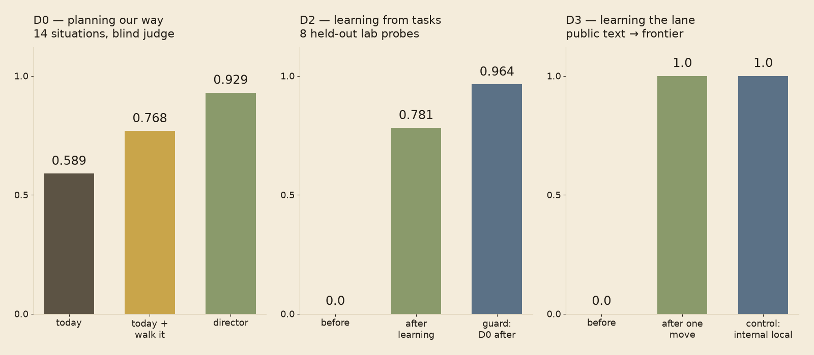

# director

**A meta-agent that keeps the lab's operational memory — how we work — and uses it to plan, delegate and
improve.** It walks the memory as a trajectory (page → atomic statement → link → statement) to plan a task,
delegates each step to Claude Code (frontier) or to local models, and proposes edits to the memory after
each task, gated and versioned, so the way of working is learned, recalled, refined and reproduced.

> **Status — 2026-10-14: D0–D3 built and measured [ran].** Planning by walking the compiled operational memory:
> **0.929** against **0.589** for today's session ([D0](docs/BRIEF-D0.md)). Learning from tasks: held-out
> lab-specific probes **0.0 → 0.781**, D0 kept at 0.964, the edit a gated agentvcs patch ([D2](docs/BRIEF-D2.md)).
> Learning where work runs: after one lane move and one reflection, public-facing drafts went **0 → 6 / 6** to the
> frontier while internal text stayed local ([D3](docs/BRIEF-D3.md)). The interface runs locally (below); the local
> lane ran live on llama.cpp.

<p align="center">
  
</p>

## How it works, in three pictures

**It plans by walking the memory.** The index names the situations a task is in; each entry statement links,
inside its own line, to the next one that applies; the plan's every step cites the statement it follows.


**It learns from a task without breaking what it knew.** After a task, the correction it received becomes a
drafted statement; the statement passes a gate (it lints clean, and a person accepts it); the edit is sealed in
agentvcs's ledger as a patch; the statement is filed where the next walk will find it (D2, D2b).


**It learns where work runs.** A plan waits; the user can move any task between the frontier and the local lane;
the move goes into the next reflection, and the director plans the next similar task in that lane (D3).


Images: [`docs/img/`](docs/img/) — the plates' prompts are in the repository's [`docs/img/IMAGES.md`](../../docs/img/IMAGES.md);
`results.png` is drawn by [`docs/img/results.py`](docs/img/results.py) from the briefs' numbers.

## Where it sits

| piece | reuses |
|---|---|
| operational memory, atomic statements with links | the memory design of [lora-kernel](https://github.com/EvolvingAgentsLabs/lora-kernel) (pages of verifiable statements; the weights hold the navigation, the base holds the content) |
| frontier lane | Claude Code, driven as `claude -p` — the isolated, audited way [agentvcs](https://github.com/EvolvingAgentsLabs/agentvcs) `merge resolve` already runs it |
| local lane | lora-kernel's gateway on llama.cpp: local experts that abstain to the frontier |
| refining without breaking | agentvcs: each memory edit is a gated patch; `blame` says which edit moved a score, `bisect` finds the one that broke it |

## The plan, in gates

| step | what | gate |
|---|---|---|
| **D0** | today's session vs a session that walks the compiled memory, on real situations | baseline below 0.85 (headroom), then treatment ≥ +0.15 — [brief](docs/BRIEF-D0.md) |
| D1 | the director's loop and its interface: the director on top (capabilities, plan, conversation), below it the frontier lane (left) and the local lane (right), from one event log | **built** — below |
| D2 | learning: memory edits proposed after each task, gated on D0's suite, versioned in agentvcs | **learns** — [brief](docs/BRIEF-D2.md) |
| D3 | the user moves a task between lanes; the move becomes a routing statement the director learns | **learns the lane** — [brief](docs/BRIEF-D3.md) |

## As a Claude Code plugin

```
/plugin install director --marketplace EvolvingAgentsLabs/evolving-agents
```

This folder is the plugin (`.claude-plugin/plugin.json`). Claude Code keeps running the session; the plugin adds
only what it lacks:

| piece | what it does |
|---|---|
| `/director:compile` | compiles your `CLAUDE.md` / `AGENTS.md`, auto-memory, agents and skills into `.director/memory/` (asks first; ~US$5 for ~60 files) |
| `SessionStart` hook | where that memory exists, puts the walk (`DIRECTOR.md`) into the session: every plan walks the memory and cites what it follows; silent elsewhere |
| `/director:reflect` | after a task, the session drafts the lesson as edits plus two probes; nothing touches the memory until you say yes |
| MCP server `director` | `memory_propose` (a candidate copy, linted, diffed), `memory_check` (D7's positive probe, in the background: TEACHES / REDUNDANT / NO EFFECT), `memory_accept` (your yes, a clean lint and — if checked — TEACHES; versioned as a gated agentvcs patch when agentvcs is installed), `memory_lint`, `memory_status` |

**Measured [ran] 2026-10-17 ([P0](docs/BRIEF-P0.md)):** the walk through the plugin's hook plans D0's 14 situations
at **0.929**, the same as the director driving Claude Code (T − P = 0.0; 27 of 28 plans cite the statements they
follow), against 0.589 for a session without it.

Not in the plugin: the targeted guard (its cases are this lab's; a project has none until it has run some), the
local lane and the two-lane interface — those stay in `director.server` below. Tests: `tests/test_plugin.py`.

## Running it (D1)

**Your own memory first.** `director.compile` reads only what you name — your `CLAUDE.md` / `AGENTS.md`, Claude Code's
auto-memory directory, any folder of agents or skills — compiles it with Claude Code (Opus by default; one compile
of ~60 files cost about US$5) into pages of atomic statements and an index of situations, lints them, and writes a
config if you have none:


```bash
python -m director.compile --claude-md ~/your-project/CLAUDE.md \
    --memory-dir ~/.claude/projects/<your-project>/memory --workdir ~/your-project
python -m director.server --config ~/.config/director/director.json      # http://127.0.0.1:8740
```

The config is private JSON: `memory_dir` (the compiled pages, `Index.md` among them), `workdir` (where frontier
tasks run), `log` (the event log), `local_base_url`/`local_model` (an OpenAI-compatible server), `director_model`,
`frontier_model`, `frontier_tools`, `plan_budget_usd`, `task_budget_usd`; optionally `guard` (D0 behind Accept, below),
`local_kind: "lora-kernel"` with `lora_kernel` (the local lane through lora-kernel's specialists, below) and
`agentvcs` (the executable that versions the memory).

- **Top:** the director — its capabilities (pages, statements, the situations it knows how to enter), the
  memory's current agentvcs version, its plan (each task with its lane and the statements it follows), the
  conversation and its walk through the memory.
- **The plan waits** for **Run plan**. Before that, any task can be moved to the other lane (**→ local** /
  **→ frontier**); the move is logged (`lane-moves.jsonl`) and becomes part of what the director reflects on.
- **After a task, Reflect** — with an optional correction. The director proposes memory edits; each proposal
  shows its edits and lint result, with **Accept** / **Reject**. Accept runs the accept gate (the candidate lints
  clean and a person accepted it), records the edit as an applied agentvcs patch (`<log dir>/vcs`) and makes it
  the live memory. Reject leaves the memory as it was.
- **Bottom left:** what it delegated to Claude Code, streamed (`claude -p --output-format stream-json`).
  Read-only tools (`Read, Grep, Glob`) unless the config grants more.
- **Bottom right:** what it delegated to local models. **The director never starts a local model**: running one
  on the user's machine is the user's decision. With no server answering, the planner is told the lane is
  offline, and a local task that still reaches it is logged `offline`.

[ran] 2026-10-14, one real request ("check that agentvcs's two READMEs state the same number of golden cases;
draft a changelog note"): the director walked 6 pages, planned 2 tasks citing 6 statements, put both on the
frontier because the local lane was offline, and the frontier verified 117 = 117 = the cases on disk.
Tests: `python -m pytest tests -q` (a fake `claude` and a fake local server; in CI).

**Accept is guarded by D0, targeted** (`"guard": {"enabled": true, "mode": "targeted", "k": 3, "config": "<private d0
config>"}`, [D6](docs/BRIEF-D6.md)): the guard re-plans only the D0 cases whose plans relied on a statement the edit
removes or changes in substance (read from the current memory's baseline, which records what each case's plans cite),
k = 3, and refuses if one of them was reliable and now fails. Validated [ran]: it refused both planted breaks (the
subtree rule, the mirror rule) and no unchanged memory, at US$1–4 per Accept instead of US$13. Thin margins (two breaks,
two unchanged arms), a refusal on a noisy case in the control, and an added statement is not checked by it — **the
positive probe is ([D7](docs/BRIEF-D7.md)):** the reflection writes two probes with each edit; on Accept they run on the
current memory and the candidate, and the lesson is kept only if it TEACHES (candidate ≥ 0.67, +0.33 over current) —
REDUNDANT and NO EFFECT are refused. Validated on D2's lessons (3 that taught, 1 the model knew: all four read right);
the probes are the lesson's own exam, so a wrong lesson can still pass — that stays the person's Accept. The baseline is per memory version and is carried forward on each
accepted edit. Its predecessors are on record: an absolute floor refused on noise; the paired guard over all 14 cases
was blind to a four-rule break ([D4](docs/BRIEF-D4.md), [D5](docs/BRIEF-D5.md)).

**The local lane through lora-kernel** (`"local_kind": "lora-kernel"`, `"local_base_url"` = lora-kernel's gateway,
`"lora_kernel": {"path", "user", "role", "org", "domains"}`): the planner is told which domains the specialists
cover; each local task carries a role token and opens a session of its own (a specialist's abstention was measured
as a session's first turn); the specialist's tool calls stream into the right lane; when it abstains, the task
goes to the frontier by itself. Ran live on lora-kernel's tracker member ([D4](docs/BRIEF-D4.md)): a domain read was served locally with its tools and an abstention went to the frontier; the specialist's abstention was not reliable outside the phrasing it was measured on.

Not yet: any write access by default; the accept path is tested in CI only where the agentvcs CLI is installed.

## Privacy

The memory is the lab's own way of working and names private work. **Code here is public; the memory, the
sandboxes built from it, the plans and the transcripts live in a private directory outside this
repository** (`~/.config/director/` by default). Case files use placeholders for private names, filled at
run time from the private config. What is published from a run is its scores.
